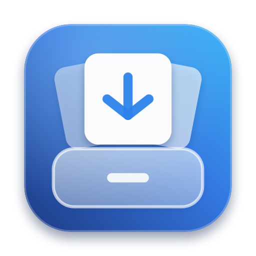

<p align="center">
  
</p>

<h1 align="center">DropShelf</h1>

<p align="center">
  轻量、开源、纯原生 macOS 拖拽中转架（Dropover 免费平替）
</p>

<p align="center">
  <a href="README_EN.md">English</a> · <strong>简体中文</strong>
</p>

<p align="center">
  
  
  
  
</p>

---

**DropShelf** 是一个用纯 Swift + AppKit 打造的 macOS 菜单栏拖拽中转架。跨文件夹整理文件、给微信/浏览器批量传附件时，不用反复切窗口——拖起文件晃一下鼠标，先丢进悬浮架里暂存，切到目标位置再一把拖走。

完全本地运行，**零联网、零广告、零第三方依赖、无需辅助功能权限**。

## 功能特性

- **摇晃鼠标呼出**：在访达或其他应用里按住文件不放，快速左右晃动鼠标即可在光标旁弹出中转架；空架约 6 秒不放入文件会自动收起。
- **全局快捷键 & 菜单栏拖放**：随时按 `⌥⇧D` 新建中转架，或直接把文件拖到右上角菜单栏图标上松手。
- **只存引用，零空间占用**：拖入中转架不会复制或修改原文件，只有在拖出到目标位置时才触发系统原生移动/复制。
- **整叠拖出 / 单个拖出**：
  - 拖动顶部「堆叠卡片」：一次性拖出架内全部文件。
  - 拖动下方任意一行：单独拖出该文件。
- **拖出模式一键切换**：在菜单栏或中转架底部徽标切换 `系统默认（同卷移动 / 跨卷复制）` 或 `仅复制（更安全）`。
- **置顶悬浮 & 跨桌面**：切换应用、切换桌面空间或全屏应用时始终稳稳浮在最上层，支持同时开启多个中转架。
- **固定 & 自动收起**：点击右上角图钉（Pin）可固定中转架不自动关闭；未固定时拖出文件后默认自动清空并收起（可在菜单栏关闭）。
- **预览与快捷操作**：支持 Quick Look 预览（空格键 / 双击 / 眼睛按钮）、一键复制全部（`⌘C`）、右键在访达中显示 / 拷贝路径 / 移除等。
- **开机自动启动**：菜单栏内置「开机自动启动」开关（通过用户级 `~/Library/LaunchAgents/` 管理，干净可控）。

## 系统要求

- **macOS 13.0 (Ventura)** 及以上
- **Apple Silicon (arm64)** 与 **Intel (x86_64)** 通用支持（Universal Binary）

## 安装方式

### 方式一：下载预编译版本（推荐）

1. 前往本仓库的 **Releases** 页面下载最新的 `DropShelf-x.x.x-universal.zip`。
2. 解压后将 `DropShelf.app` 拖入 `/Applications`（应用程序）文件夹。
3. **首次打开提示**：由于个人开源项目未使用付费 Apple 开发者账号进行公证，首次打开时 macOS 可能会提示「无法验证开发者」或「已损坏」。请任选以下一种方式放行：
   - **方法 A（终端推荐）**：
     ```bash
     xattr -cr /Applications/DropShelf.app
     open /Applications/DropShelf.app
     ```
   - **方法 B（图形界面）**：在「应用程序」里右键点击 `DropShelf.app` → 选择「打开」→ 弹窗中再次点击「打开」。

### 方式二：从源码一键编译

只需安装 macOS 命令行工具（`xcode-select --install`），无需打开 Xcode：

```bash
git clone https://github.com/haisengberg/DropShelf.git
cd DropShelf

# 编译 Universal 通用包（输出到 dist/DropShelf.app）并安装到 /Applications
./build.sh --install
```

常用构建参数：

```bash
# 仅编译当前芯片架构（速度更快）
./build.sh --arch arm64

# 打包 Universal 通用包 + Release 压缩包与 SHA-256 校验文件
./build.sh --release

# 自定义 Bundle ID 和版本号
BUNDLE_ID=io.github.yourname.DropShelf VERSION=1.0.1 ./build.sh --release
```

## 快捷键与操作一览

| 操作 | 触发方式 |
| --- | --- |
| 拖拽时呼出中转架 | 按住文件快速左右晃动鼠标 |
| 新建中转架 | `⌥⇧D`（Option + Shift + D） |
| 快速新建并放入文件 | 直接将文件拖到菜单栏图标上 |
| 预览选中文件 | `Space`（空格） / 双击 / 点击预览图标 |
| 复制全部文件 | `⌘C` 或点击底部「复制全部」 |
| 关闭当前中转架 | `Esc` 或点击右上角关闭按钮 |

## 项目结构

```text
DropShelf/
├── Sources/
│   ├── main.swift                   # 应用入口
│   ├── AppDelegate.swift            # 生命周期、单实例检查、菜单栏与热键挂载
│   ├── StatusBarController.swift    # 菜单栏图标、下拉菜单与拖放接收
│   ├── ShakeDetector.swift          # 鼠标左键拖拽晃动识别算法（无需辅助功能权限）
│   ├── HotKeyManager.swift          # Carbon 全局快捷键 (⌥⇧D)
│   ├── ShelfManager.swift           # 多中转架窗口调度、定位与避让
│   ├── ShelfPanel.swift             # 悬浮置顶、跨空间非激活 NSPanel
│   ├── ShelfViewController.swift    # 中转架交互逻辑、Quick Look 与菜单
│   ├── ShelfViews.swift             # 原生 AppKit UI 组件与拖拽会话
│   ├── ShelfItem.swift              # 文件引用模型与缩略图读取
│   ├── Preferences.swift            # UserDefaults 偏好设置管理
│   └── LaunchAtLoginManager.swift   # LaunchAgents 开机自启管理
├── Resources/
│   └── Info.plist                   # 应用元数据（LSUIElement 纯菜单栏模式）
├── Scripts/
│   └── generate_icon.swift          # CoreGraphics 矢量生成 AppIcon.icns
├── assets/
│   └── icon.png                     # README 展示图标
├── .github/workflows/release.yml    # GitHub Actions 自动构建与 Release 发布
├── build.sh                         # Universal 通用包编译与打包脚本
└── LICENSE                          # MIT 开源协议
```

## 常见问题

**Q：为什么不需要「辅助功能」权限也能检测晃动鼠标？**  
DropShelf 仅通过 macOS 公开的 `NSEvent.pressedMouseButtons` 与 `NSEvent.mouseLocation` 检测左键按住时的方向反转，不监听键盘输入、不读取屏幕内容，因此不需要敏感系统权限。

**Q：把文件拖进中转架后，删除中转架会影响原文件吗？**  
完全不会。中转架只保存文件路径引用，移除或关闭中转架不会对硬盘上的原文件做任何改动。

**Q：如何彻底卸载？**  
1. 先在菜单栏取消勾选「开机自动启动」（或删除 `~/Library/LaunchAgents/dev.dropshelf.DropShelf.plist`）。
2. 退出 DropShelf，将 `/Applications/DropShelf.app` 移到废纸篓即可。

## 参与贡献

欢迎提 Issue、功能建议或 Pull Request！具体规范见 [CONTRIBUTING.md](CONTRIBUTING.md)。

## 开源协议

本项目基于 [MIT License](LICENSE) 开源。
