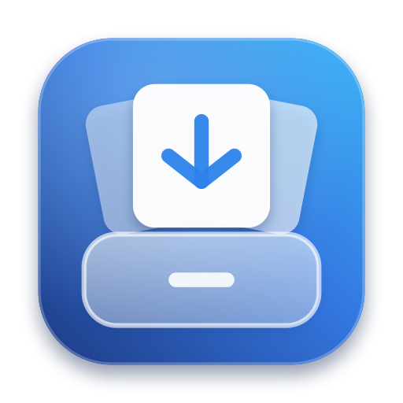

<p align="center">
  
</p>

<h1 align="center">DropShelf</h1>

<p align="center">
  A lightweight, free & open-source, native macOS floating drag-and-drop shelf
</p>

<p align="center">
  <strong>English</strong> · <a href="README.md">简体中文</a>
</p>

<p align="center">
  
  
  
  
</p>

---

**DropShelf** is a native Swift + AppKit menu bar utility for macOS that gives you instant floating shelves to stash files mid-drag. Collect files from multiple folders, switch windows or Spaces freely, and drop them all at once into Finder, chat apps, or browser upload boxes.

100% local — **zero network calls, zero ads, zero third-party dependencies, and no Accessibility permission required**.

## Features

- **Shake to Open**: While dragging files, shake your cursor back and forth to summon a floating shelf right next to the pointer. Empty shake-triggered shelves auto-dismiss after ~6 seconds.
- **Global Hotkey & Menu Bar Drop**: Press `⌥⇧D` (Option + Shift + D) anywhere to open a shelf, or drop files directly onto the menu bar icon.
- **Live File-Reference Tracking & Missing Badge**: Staging stores native macOS file references (inode-backed) with zero disk bloat—renaming or moving a file on the same volume updates automatically in place, while deleted or trashed files display a clear **Missing** badge instead of silently breaking.
- **Drag All or Single Item**:
  - Drag the stacked card at the top to drag **all** available staged files together.
  - Drag any individual row to drag just that file.
- **Explicit Move/Copy vs. Copy Only Indicators**: The stack card, footer toggle badge, tooltips, and drag preview explicitly show whether dragging out will **Move/Copy** (same-volume move / cross-volume copy, hold `⌥` to copy) or **Copy Only** (never moves originals). Toggle with one click in the footer or menu bar.
- **Always-on-Top & Cross-Space**: Floating non-activating panels stay visible across windows, Spaces, and full-screen apps, with multiple shelves supported simultaneously.
- **Pin & Auto-Close**: Pin any shelf to keep it open; unpinned shelves optionally clear and close automatically after dragging files out.
- **Quick Look & Actions**: Preview files with `Space`, double-click, or the eye button; copy all files (`⌘C`); right-click to reveal in Finder, copy file/path, or remove.
- **Launch at Login**: Built-in menu bar toggle backed by a clean user `LaunchAgents` plist.

## Requirements

- **macOS 13.0 (Ventura)** or later
- **Universal Binary** supporting both Apple Silicon (`arm64`) and Intel (`x86_64`)

## Installation

### Option 1: Download Prebuilt Release

1. Download the latest `DropShelf-x.x.x-universal.zip` from the **Releases** page.
2. Unzip and move `DropShelf.app` to `/Applications`.
3. **First launch (unsigned app)**: Because this community build is ad-hoc signed without a paid Apple Developer notarization certificate, macOS Gatekeeper may block the first launch. Clear the quarantine attribute and open it:
   ```bash
   xattr -cr /Applications/DropShelf.app
   open /Applications/DropShelf.app
   ```

### Option 2: Build from Source

Requires only macOS Command Line Tools (`xcode-select --install`) — no Xcode IDE needed:

```bash
git clone https://github.com/haisengberg/DropShelf.git
cd DropShelf

# Build Universal app bundle (dist/DropShelf.app) and install to /Applications
./build.sh --install
```

Useful build options:

```bash
# Build single architecture only (faster local iteration)
./build.sh --arch arm64

# Build Universal app + GitHub Release .zip and .sha256
./build.sh --release

# Override Bundle ID and version
BUNDLE_ID=io.github.yourname.DropShelf VERSION=1.0.1 ./build.sh --release
```

## Shortcuts

| Action | Trigger |
| --- | --- |
| Summon shelf while dragging | Shake cursor while holding primary mouse button |
| New shelf at cursor | `⌥⇧D` (Option + Shift + D) |
| Drop to create shelf | Drop files onto the menu bar icon |
| Quick Look preview | `Space` / double-click / eye button |
| Copy all staged files | `⌘C` or click Copy All |
| Close focused shelf | `Esc` or click close button |

## Contributing

Bug reports, feature ideas, and pull requests are welcome! See [CONTRIBUTING.md](CONTRIBUTING.md).

## License

Released under the [MIT License](LICENSE).
